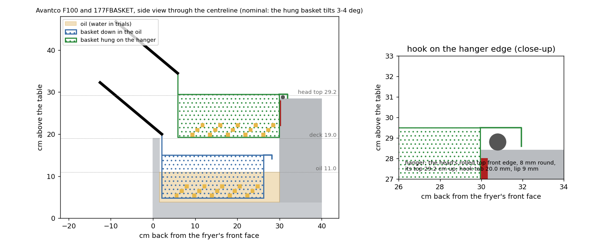

# Lift a loaded fry basket out of the oil and hang it on the fryer's hanger to drain

An Avantco F100 countertop electric fryer stands on the table, its front toward the arms. Its own wire basket (the
Avantco 177FBASKET), holding a half-pound batch of 30 fries, is down in the oil on the tank's bottom grate, its coated
handle rising toward the arms. The instruction is: **"Lift the fry basket out of the oil and hang it on the fryer's
hanger to drain."** The fryer's own basket hanger is its control head's rolled top front edge: the basket's hook goes
over it, and the basket's back rests against the head's front face, the way the F100 is pictured with its basket
hanging.

To do it, the robot has to:
- take the basket by its coated grip (as cooks do: the wire basket, its bare riser and its hook are as hot as the oil).
  The 9.5 in handle is a 5 cm bare riser and then a 19 cm coated grip, so a hand on the grip is 5 to 20 cm from the
  basket and the basket's weight (about 0.63 kg with the fries) acts with a long lever on the hand and wrist;
- lift the basket straight up out of the oil, level enough that the fries stay in;
- raise it until its hook clears the hanger edge, push it back until its back meets the head's face, and lower it so
  the hook settles over the edge and takes the weight;
- let go and move clear, leaving it hanging over the tank to drain;
- keep every part of itself out of the oil, and off the basket except its coated grip, throughout.



*Side view through the fryer's centreline, drawn from `geometry.py` by `sketch.py` (nominal geometry; the hung basket
really tilts 3 to 4 degrees): the basket down in the oil (blue), hung on the hanger edge (green), and the hook in
close-up.*

## Why it matters

Restaurant cooks (about 1.4 million in the US), fast food cooks (about 0.6 million) and fast food and counter workers
(about 3.9 million, who run the fryer in many quick-service kitchens) fry food all shift. O*NET lists "Operate
large-volume cooking equipment, such as grills, deep-fat fryers, or griddles" among the core tasks of fast food cooks
(35-2011). Countertop units like the F100 serve concession stands, food trucks and small kitchens with the same
lift-and-hang workflow as floor fryers. Every batch ends with this step: lift the basket out of the oil by its handle, keep it level so the food
stays in, and hang it on the fryer's hanger so the oil drains back into the tank. Left in the oil, the food overcooks;
tipped, it spills; a hand in the oil, or on the basket's wire, is a serious burn.

The task tests:
- **Handling a load on a long lever.** The grip is well away from the load. The hand has to keep the basket level
  against the moment of its weight while the arm moves it.
- **Engaging a hook.** The hook has to pass over the hanger edge and drop behind it, which needs the basket raised,
  moved back and lowered in that order.
- **Safety around hot oil and a hot basket.** Touching the oil, or the basket anywhere but its coated grip, voids the
  trial. (The fryer's own housing is not scored; real trials are with the fryer cold.)

No task on the board lifts or hangs a fryer basket. The nearest are #1814 (unhook an air fryer basket's trivet) and
#1435 (flip a pancake by the pan's handle).

## Files

| File | What |
|---|---|
| `task.py` | The yam_arena task file: the fryer, the basket and the fries, the monitor (basket height, hook, fries, oil, contact), `success()` and `score()` |
| `geometry.py` | Dimensions and layout: the F100, its hanger, the 177FBASKET, the fries, the scoring tolerances |
| `build_assets.py` | Writes `assets/fryer.usda` and `assets/basket.usda` (needs `pxr`) |
| `sketch.py` | Draws `side_view.png` from `geometry.py` (needs matplotlib) |
| `assets/` | The fryer (fixed) and the basket (free) |
| `scenekit.py` | USD bodies and reset hooks for yam_arena task files |
| `demokit.py` | Helpers for the scripted demo |
| `demo.py` | The scripted full-score demo, and variants that hold the basket out without hanging it, or lower it onto the hanger but keep hold |

`scenekit.py` hooks `yam_arena.scene` and the embodiment's step and reset without modifying yam_arena, so the task runs
with the standard `yam_arena` embodiment and `task_score` scorer. Tested with yam-isaac-lab-arena at `bd62771` (Isaac
Lab-Arena 0.3.1). All the assets are generated by `build_assets.py` from `geometry.py`; there are no third-party models,
textures or fonts.

## Run a trial

From this folder, in a shell with the yam_arena environment active (`source <ARENA_DIR>/yam.env` off the walkthrough's
Brev instance):

```bash
inspect-robots run --embodiment yam_arena --policy dream \
  -E task=task.py -E object_jitter=0 -E control_hz=20 -E cam_width=320 -E cam_height=176 \
  --instruction "Lift the fry basket out of the oil and hang it on the fryer's hanger to drain." \
  --scorer task_score --max-steps 2400 --store-frames --log-dir ~/yam-eval/fryer-dream
```

`task_score` prints the trial's score: 1.0 on success, otherwise `score()` at the end of the episode.

- **Seeds:** one fixed layout and no randomisation (`object_jitter=0`), so the seed has no effect.
- **Runtime:** a full 2,400-step Dream-1 trial took 7 min 12 s on an RTX 5090 (mean inference latency 0.70 s),
  plus about a minute to start Isaac Sim. A successful trial ends earlier: the scripted demo stops after 432 steps.

Dream-1 scored 0. Its hands reached the basket but never lifted it: the basket stayed on the grate in the oil, with
all its fries, and no part of the robot went into the oil. This run predates two last changes, a wider red panel
(drawn only); as it never lifted the basket, this doesn't affect it. The run used one
continuous Dream-1 session, with no errors or retries.

## Scripted demo

```bash
python demo.py task.py demo_out                 # full score: demo_*_cam.mp4, setup.png, result.json
python demo.py task.py hold_out --hold          # lifts it out and holds it over the tank: 0.5
python demo.py task.py keep_out --keep-hold     # lowers it onto the hanger but keeps hold of the grip: 0.5
```

1. The left hand comes in level from the left, square across the handle, fingers part-open, and closes on the coated
   grip 7 cm from its root: fingers above and below the flat grip, finger plates along it.
2. It lifts the basket straight up until its hook's lip is 3 cm above the hanger edge, keeping it level.
3. It pushes the basket back about 3.8 cm, until its back meets the head's face and the hook's lip is behind the edge.
4. It lowers the basket until the hook takes it, eases its command to where the hand really is (so it doesn't spring
   up when the load comes off), opens part-way (fully open, the lower finger would reach the basket), drops below the
   grip, backs off and goes home.

Every move follows the basket's measured pose. The arm sags 4 to 9 cm under the basket, so the hand's command is
corrected each step by the basket's position and tilt errors, and each move waits until the basket is close to its
goal. The lowering is not corrected, so the hanger, not the hand, ends up carrying the basket.

The demo succeeds (1.0) in 432 steps (22 s): the basket hangs with its floor 18.0 cm above the table (7.0 cm above the
oil), tilted 3.9 degrees, with all 30 fries in it; no part of the robot came within 5 cm of the wire basket, riser or
hook. The variants:
- `--hold` lifts it out (floor 20.9 cm up) and holds it: 0.5 (376 steps).
- `--keep-hold` lowers it onto the hanger but keeps hold of the grip: 0.5 (526 steps).

The scripted variants don't show the 0.25 row (one to three fries lost) or the two latches (oil, hot basket); those
are simple checks in `score()`, from the fries' positions in the basket's frame and from the arms' collision hulls.

## Scoring

Judged at the end of the trial from the video (all three cameras) and a photo of the fryer. Take the first row that
applies.

- **Rules over the whole trial:** any part of the robot in the oil (water in trials), or any visible contact between the
  robot and the basket's wire, rim, riser or hook in any camera view, scores 0. The coated grip (up to the tape) is the
  only part of the basket it may touch. Contact is judged from every camera and by an observer standing beside the fryer, who watches the riser and the hook (the wrist cameras can be blocked there). Fries are counted by those outside the basket (on the table, deck or in the tank); a broken fry counts as out if any piece is out. Shaking the basket before hanging it is neither required nor penalised.

| Score | When |
|---|---|
| 0 | Any part of the robot went into the oil, or touched the basket anywhere but its coated grip, at any time |
| 1.0 (success) | For the whole last 1 s: the basket hangs from the hanger edge by its hook (not resting on the deck or rims), its floor (every corner) 2 cm or more above the oil and its centre over the tank's opening, all 30 fries in it, and no part of the robot within 2 cm of the basket. This ends the trial |
| 0 | The basket rests on the fryer (its deck, rims or the head's top; anywhere but the hanger), whether or not the robot is near it |
| 0.5 | The basket's floor is 2 cm or more above the oil, its centre over the tank's opening, with all 30 fries in it, and it is either held (a hand on its coated grip) or hanging by its hook |
| 0.25 | The same, but with one to three fries out of the basket |
| 0 | Anything else: still in the oil, dropped, laid across the rims, carried off the fryer, or more fries lost |

- **Hung:** the hanger edge is inside the hook: between the basket's back wall and the hook's lip, under the tab (3 mm
  tolerance) and no lower than the lip's lower end.
- **Resting on the fryer:** in simulation, a corner of the basket or the hook's lip outside the tank's opening and no
  more than 3 mm above the surface under it (the deck, or the head's top), unless the basket is hung.
- **Held:** in simulation, part of a hand within 2 mm of the coated grip.
- **In the basket:** a fry's middle is inside the basket's walls and above its floor (within 5 mm), up to 1 cm above
  its rim.
- **In simulation:** the oil fills the tank up to a fixed height. Every control step, the arms' collision hulls (every
  link, the gripper body and both fingers) are checked for overlap with that volume, for touching the basket's floor,
  walls, riser, hook tab or lip (within 2 mm, the simulation's stand-in for visible contact), and for the 2 cm clearance from the basket and its handle.

## Real-world build

All positions are in cm from the midpoint between the arm bases: x forward, y to the robot's left; heights are above
the table top.

- **Fryer.** An Avantco F100 10 lb countertop electric fryer (item 177F100), as supplied: 10.5 x 15.75 x 11.5 in
  overall (26.7 x 40 x 29.2), a 9.5 x 12 x 6 in tank. Front at x 27, centred at y +5. **Switched off and unplugged; the
  tank holds water at room temperature, filled to the tank's MAX line (about 4.9 L, the 10 lb oil level; its surface
  about 11 above the table). The 2 cm floor clearance is measured from the actual water surface.** Never run a trial with the fryer
  hot.
  - Measured from the maker's product photos, scaled by the listed sizes (not on the spec sheet): the body's top
    (deck) is 19 above the table; the control head covers the back of the tank from 30 behind the front, its flat top
    28.4 up; the hanger is the head's rolled top front edge, an 8 mm round lip standing on it, its top at the listed
    29.2, 0.8 behind the head's face (see the side view); the thermostat dial is at the right of the head's red panel,
    beside a hung basket. Check these on the unit; the task's heights follow the unit as built.
- **Basket.** The F100's own wire basket, Avantco 177FBASKET (the current version: 9.5 in front to back, 7.25 in
  across, 4 in deep; 24.1 x 18.4 x 10.2 cm), with a 9.5 in
  handle (a 5 cm bare riser from the front wall, then a 19 cm flat coated grip rising toward the arms at about 40
  degrees) and a front hook (6 wide, reaching 2.0 back from the end opposite the handle, its lip 0.9 down). About 0.4 kg (estimated:
  the maker lists no net weight). If the older version listed in the
  F100's manual (7.25 x 8.25 x 4.5 in) is what arrives, use it unchanged, its back wall 26.2 behind the front as here:
  the hook, hanger and scoring are the same, and the hung floor is still above the water by 7 cm or more. Wrap a strip of
  tape round the handle where its coating ends, so the cameras show the edge of the grip. It rests on the tank's bottom grate, its back wall 26.2 behind the fryer's front.
- **Fries.** A half-pound (230 g) batch: 30 straight-cut fries, 1 x 1 x 7 cm, about 7.7 g each (thawed frozen fries;
  1.1 g/cm3), in three layers. Use a fresh batch every 5 trials, or sooner if any fry breaks. A fry broken during a
  trial counts as in the basket only if all its pieces are in it. The F100's manual allows up to 1.98 lb a pot.
- **Arms** start at the ready pose with open grippers.

## Simulation fidelity

- Rigid bodies, 240 Hz physics, 20 Hz control.
- The fryer is one fixed body; the basket (thin collision shells for its floor and walls, a drawn wire mesh, the riser,
  the coated grip and the hook) and the 30 fries are free bodies.
- **Oil:** a drawn surface only, with no buoyancy, drag or dripping; being in it is judged from heights and volumes.
- **Basket mass:** 0.40 kg, estimated (the maker lists no net weight).
- **Fries:** real fries are softer and cling together a little.
- **Measured from photos:** the sizes not in the maker's sheets (below) come from the maker's photos, scaled by listed
  sizes.

### Sizes measured from the maker's photos

| Size | Value | Photo | Scale reference |
|---|---|---|---|
| Deck (body top) | 19 cm | F100 spec sheet, page 1, front three-quarter photo with the basket hung | the listed 11.5 in overall height and 10.5 in width |
| Head's flat top, hanger lip | 28.4 cm; an 8 mm round lip to 29.2 | same photo | the listed 11.5 in overall height |
| Hook | reaches 2.0 cm, lip 0.9 cm | F100/F102 manual, page 9, parts diagram item 4 (basket with front hook) | the basket's listed 4 in depth |
| Handle | 5 cm bare riser, then 19 cm coated grip at about 40 degrees | 177FBASKET listing photo; F100 spec sheet photos | the listed 9.5 in handle |

**Sensitivity**, checked by `../dev/sweep_fryer.py` (offline: the start, the scorer's view of the hung basket, the hook's
clearances and the arm's reach) and by full demo runs at the two worst cases:

| Change | Offline checks | Full demo run |
|---|---|---|
| none (as built) | pass | 1.0 (432 steps) |
| hook reach -3 or +3 mm | pass (lip 1.5 or 7.5 mm behind the hanger) | not run alone |
| hook lip -3 mm | pass | not run alone |
| hook lip +3 mm | the lip reaches 1 mm below the head's top: it, not the tab, bears there; still read as hung | not run alone |
| handle -5 or +5 deg | pass | +5 deg with deck +1 cm: 1.0 (432 steps) |
| deck -1 or +1 cm (tank and oil with it) | pass (floor 9.3 or 7.3 cm above the oil when hung) | see above |
| hook reach -3 mm and lip +3 mm together | lip only 1.5 mm behind the hanger | **0**: the demo's hook didn't seat and the basket went back on the grate |

So the task (scene and scorer) holds across these ranges, but the scripted demo's hook placement does not tolerate the
tightest hook: a real build should measure the delivered basket's hook reach and lip (and use the older basket version only after re-running `demo.py` with its sizes) before trials.

### Load on the arm

The basket and fries weigh about 0.63 kg. Held by the grip 7 cm from its root, their
centre is about 17 cm out from the hand (5.4 cm along the grip plus half the basket), a moment of about
0.63 x 9.81 x 0.17 = 1.1 N m at the wrist. The YAM's wrist motors (DM4310, joints 4 to 6) are
rated 7 N m peak (yam_arena's limit), so the motors have margin; with their 10 N m/rad holding stiffness the wrist sags
about 6 to 8 degrees, which the demo corrects in closed loop. The shoulder and elbow (DM4340, 27 N m) carry about
2.8 N m at 45 cm reach. The grip holds the coated bar between two flat finger pads by friction.

## Reset between trials

Put any spilled fries back in the basket in three layers (a fresh batch every 5 trials, or sooner if any fry breaks),
lower the basket onto the bottom grate with its back wall 26.2 cm behind the fryer's front, top the water up to the MAX
line, and wipe any water off the deck and the arms.

## Sources

- Avantco F100 spec sheet: <https://www.webstaurantstore.com/documents/specsheets/avantco_equipment_177f100.pdf>
- Avantco F100/F102 user manual (tank and basket sizes, the 1.98 lb a pot limit, the parts list naming the 177FBASKET
  "Fryer Basket with Front Hook"): <https://www.webstaurantstore.com/documents/pdf/177f100-f102_manual.pdf>
- Avantco 177FBASKET listing (9.5 x 7.25 x 4 in, 9.5 in coated handle, fits the F100):
  <https://www.webstaurantstore.com/avantco-177fbasket-9-1-2-x-7-1-4-x-4-fryer-basket-with-front-hook/177FBASKET.html>
- O*NET 35-2011.00, Cooks, Fast Food: <https://www.onetonline.org/link/details/35-2011.00>
